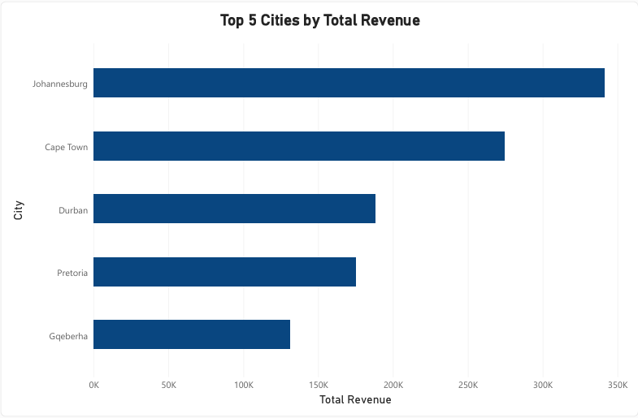
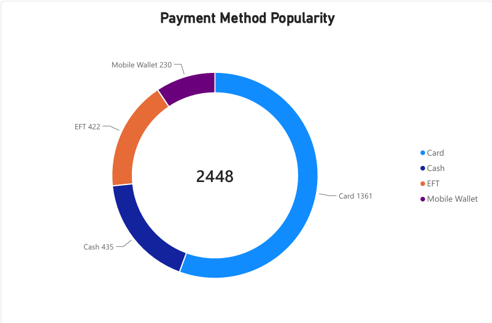

# South African Retail Sales Analysis 

## Introduction
This project involves analysing a South African retail sales dataset to understand sales performance, customer behaviour and product profitability 
I used Python for data cleaning and SQL for data analysis to extract meaningful insights that will help make better business decisions

## Background
The dataset represents a fictional South African retail business operating across different cities in South Africa.

It contains 2,500 records and 15 columns, covering transactions, customers, products, sales, costs, and profits.

The raw dataset contains several data quality issues, including:

- Missing values
- Duplicate records
- Inconsistent formatting
- Incorrect data types
- Unusual values and outliers

The purpose of the analysis is to clean the data and investigate important business questions.

## Tools I Used
- Python: Data Cleaning
- Pandas: Manipulate and clean dataset
- PostgreSQL: Query the data and perform business analysis
- Visual Studio Code: IDE
- GitHub: Manage and document project

## The Analysis
### **1. What is the total revenue, estimated profit and units sold?**
```sql
SELECT 
    SUM(quantity) AS total_units_sold,
    SUM(revenue_zar) AS total_revenue, 
    SUM(profit_zar) AS profit
FROM retail_sales;
```
**Results**
| Total Units Sold | Total Revenue (ZAR) | Total Profit (ZAR) |
| :---: | :---: | :---: |
| **4,183** | **R 1,569,729.84** | **R 680,445.08** |

**Insights**
- The Store generated R680 445 in profit from R1 569 729 Revenue.
- Sold 4183 units and generated R1 569 729 Revenue 

### **2. how does revenue trend look like over the last 12 months?**
```sql
SELECT 
    order_date as month,
    sum(revenue_zar) as total_revenue  
FROM retail_sales
GROUP BY order_date
ORDER BY order_date;
```
**Results**


**Key Insights**
- The business hits its highest revenue in August and October with R154K.
- November is the lowest performing month of the year
- In the first Quarter, March and April performed the lowest
- The store has a healthy baseline, never dropping below R110K

### **3. Which product categories generate the most revenue and profit?**

```sql
SELECT 
     product_category,
     SUM(revenue_zar) AS Revenue,
     SUM(profit_zar) AS Profit
FROM retail_sales
GROUP BY product_category
ORDER BY Revenue DESC, Profit DESC
```
**Result**


**Key Insights**
- Home & Kitchen generates the highest revenue and profit
- Clothing and Electronics are also strong secondary drivers of revenue and profit
- Groceries generates the lowest revenue and profit compared to the others

**Recommendations**
- Make sure the stock for Home & Kitchen and Clothing is always available
- Because Groceries have the lowest revenue and profit margins, the business should reduce grocery inventory to prevent dead stock

## 4. Which individual products perform best and worst?
```sql
SELECT 
    product_name AS Product_Name,
    SUM(profit_zar) AS Profit
FROM retail_sales
GROUP BY product_name
ORDER BY Profit DESC;
```

**Results**

| Rank | Product Name | Total Profit (ZAR) |
|:---:|:---|-------------------:|
| 1 | Air Fryer | **R 56,538.15** |
| 2 | Cookware Set | **R 53,469.62** |
| 3 | Jacket | **R 51,423.88** |
| 4 | Perfume 50ml | **R 34,362.65** |
| 5 | Sneakers | **R 33,491.53** |
| 6 | Headphones | **R 31,154.98** |
| 7 | Bluetooth Speaker | **R 29,347.34** |
| 8 | Hoodie | **R 29,131.55** |
| 9 | Jeans | **R 28,090.89** |
| 10 | Backpack | **R 27,251.76** |
| 11 | Bed Linen Set | **R 26,319.12** |
| 12 | Electric Trimmer | **R 25,041.48** |
| 13 | Keyboard | **R 22,593.13** |
| 14 | Dumbbell Pair | **R 21,747.53** |
| 15 | Power Bank | **R 20,535.81** |
| 16 | Electric Kettle | **R 18,031.90** |
| 17 | Yoga Mat | **R 17,926.09** |
| 18 | Camping Chair | **R 17,443.11** |
| 19 | Desk Lamp | **R 16,166.76** |
| 20 | USB-C Charger | **R 14,156.02** |
| 21 | Wireless Mouse | **R 13,793.81** |
| 22 | T-Shirt | **R 12,164.63** |
| 23 | Storage Set | **R 10,412.98** |
| 24 | Face Moisturiser | **R 9,357.65** |
| 25 | Sunscreen | **R 8,321.55** |
| 26 | Water Bottle | **R 7,944.26** |
| 27 | Body Lotion | **R 7,358.72** |
| 28 | Olive Oil 500ml | **R 6,330.53** |
| 29 | Socks Pack | **R 5,329.60** |
| 30 | Skipping Rope | **R 4,606.02** |
| 31 | Tea 100 Pack | **R 4,363.27** |
| 32 | Shampoo 400ml | **R 4,255.42** |
| 33 | Coffee 250g | **R 3,956.32** |
| 34 | Cereal 1kg | **R 3,584.75** |
| 35 | Peanut Butter | **R 2,639.07** |
| 36 | Rice 2kg | **R 1,803.20** |

**Key Insights**
- The top two products: Air Fryer and Cookwar Set are both high selling Home & Kitchen items, generating over R100K
- Groceries such as Rice, Peanut Butter, Cereal, Coffee generate the lowest profit.

**Recomemendation**
- Ensure the Top 10 products are always well stocked. They are the primary profit engines
- Create bundle promotions for the low-margin grocery items to drive more traffic

## 5. Which top 5 cities generate the most revenue?

```sql
SELECT 
    city,
    SUM(revenue_zar) AS total_revenue
FROM retail_sales
GROUP BY city
ORDER BY total_revenue DESC
LIMIT 5;
```
**Results**



| Rank | City | Total Revenue (ZAR) |
|:---:|:---|-------------------:|
| 1 | **Johannesburg** | R 341,241.69 |
| 2 | **Cape Town** | R 274,621.18 |
| 3 | **Durban** | R 187,911.89 |
| 4 | **Pretoria** | R 175,345.71 |
| 5 | **Gqeberha** | R 130,986.99 |

**Key Insights**
- Johannessburg generates the most revenue than any other city
- The gap between Johannesburg and Gqeberha is significant suggesting that Gqeberha operates in a smaller economic tier.

**Recommendation**
- Allocate a significant portion of the marketing and advertising budget to Johannesburg to maintain and grow that dominant market share.
- Gqeberha is the lowest performer on this list. The business should investigate why sales are lower. Is it a lack of localized marketing? Delivery delays? Or simply a smaller customer base? A targeted local promotion could help close the gap

## 6. Which sales channel performs best?

```sql
SELECT 
        COUNT(transaction_id) AS Total_Transactions,
        sales_channel,
        SUM(revenue_zar) AS Revenue,
        SUM(profit_zar) AS Profit
FROM retail_sales
GROUP BY sales_channel
ORDER BY Revenue DESC;
```
**Result**

| total_transactions | sales_channel | revenue | profit |
| :--- | :--- | :--- | :--- |
| 1164 | In-store | 748786.22 | 322590.89 |
| 923 | Online | 574752.49 | 251102.78 |
| 361 | Click & Collect | 246191.13 | 106751.41 |

**Key Insights**
- In-Store brings the highest revenue and overall profit. It also handles the most transactions (1164).
- Online is a strong secondary revenue and profit driver with 923 transactions and Click & Collect is significantly smaller with 361 transactions

**Recommendation**
- Focus marketing and inventort efforts on maintaining the in-Store dominance.
- Run targeted promotions for Online sales.

## 7. Which payment methods are most popular?

```sql
SELECT 
    COUNT(transaction_id) AS Total_Number,
    payment_method
FROM retail_sales
GROUP BY payment_method
ORDER BY Total_Number DESC;
```

**Results**



**Key Insights**
- Card account for 1361 transactions, which is more than half of all payments. This show customers prefer using card payments

**Recommendation**
- Ensure your card payment terminals are fast and reliable.
- Look into why Mobile Wallets are underperforming.

## 8. What patterns can you identify among repeat customers?

```sql
WITH order_level AS (
    SELECT
        customer_id,
        order_id,
        order_date,
        SUM(revenue_zar) AS order_revenue,
        SUM(profit_zar) AS order_profit,
        SUM(quantity) AS order_quantity
    FROM retail_sales
    GROUP BY customer_id, order_id, order_date
),

customer_summary AS (
    SELECT
        customer_id,
        COUNT(DISTINCT order_id) AS total_orders,
        SUM(order_revenue) AS total_spent,
        SUM(order_profit) AS total_profit,
        SUM(order_quantity) AS total_quantity_purchased,
        ROUND(AVG(order_revenue), 2) AS avg_order_value,
        MIN(order_date) AS first_order_date,
        MAX(order_date) AS last_order_date,
        MAX(order_date) - MIN(order_date) AS customer_lifespan
    FROM order_level
    GROUP BY customer_id
)

SELECT 
    customer_id,
    total_orders,
    total_spent,
    total_profit,
    total_quantity_purchased,
    avg_order_value,
    first_order_date,
    last_order_date,
    customer_lifespan,
    CASE
        WHEN total_orders = 1 THEN 'One-time Customer'
        WHEN total_orders BETWEEN 2 AND 3 THEN 'Occasional Customer'
        WHEN total_orders BETWEEN 4 AND 6 THEN 'Regular Customer'
        ELSE 'Frequent Customer'
    END AS customer_segment
FROM customer_summary
WHERE total_orders > 1
ORDER BY total_spent DESC
LIMIT 10;
```
**Results**

| customer_id | total_orders | total_spent | total_profit | total_quantity_purchased | avg_order_value | first_order_date | last_order_date | customer_lifespan | customer_segment |
| :--- | :---: | :---: | :---: | :---: | :---: | :--- | :--- | :---: | :--- |
| CUST00584 | 101 | 57561.45 | 25297.94 | 158 | 558.85 | 2025-01-03 | 2025-12-26 | 357 | Frequent Customer |
| CUST00371 | 83 | 54641.98 | 23465.81 | 121 | 635.37 | 2025-01-04 | 2025-12-25 | 355 | Frequent Customer |
| CUST00615 | 40 | 24300.54 | 10545.30 | 61 | 592.70 | 2025-01-03 | 2025-12-31 | 362 | Frequent Customer |
| CUST00616 | 31 | 20997.76 | 8628.65 | 44 | 677.35 | 2025-01-13 | 2025-12-22 | 343 | Frequent Customer |
| CUST00421 | 29 | 20127.83 | 8481.00 | 44 | 694.06 | 2025-01-02 | 2025-12-13 | 345 | Frequent Customer |
| CUST00035 | 28 | 19622.26 | 8994.91 | 51 | 676.63 | 2025-01-06 | 2025-12-09 | 337 | Frequent Customer |
| CUST00014 | 33 | 19449.07 | 8317.38 | 46 | 589.37 | 2025-01-14 | 2025-12-28 | 348 | Frequent Customer |
| CUST00181 | 15 | 19109.86 | 8106.94 | 32 | 1273.99 | 2025-02-24 | 2025-11-22 | 271 | Frequent Customer |
| CUST00692 | 23 | 16293.87 | 7063.60 | 33 | 708.43 | 2025-01-17 | 2025-12-30 | 347 | Frequent Customer |
| CUST00659 | 19 | 15350.16 | 6324.04 | 34 | 807.90 | 2025-02-12 | 2025-12-23 | 314 | Frequent Customer |

**Key Insights**
- The top two customers (CUST00584 and CUST00371) are extreme outliers. With 101 and 83 orders respectively, they shop almost weekly. Together, they generated over R112,000 in revenue.
- There are two distinct types of top spenders. CUST00584 buys frequently but has a lower average order value (R558), while CUST00181 bought only 15 times but has the highest average order value (R1,273) among the top 10, indicating a preference for premium, high-ticket items.
  
**Recommendation**
- Offer a "points multiplier" or free shipping on smaller orders to keep them coming back weekly.

## Conclusion
