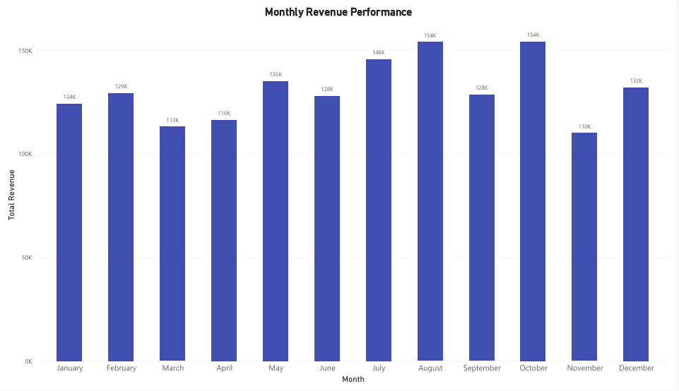

# South African Retail Sales Analysis 

## Introduction
This project involves analysing a South African retail sales dataset to understand sales performance, customer behaviour and product profitability 
I used Python for data cleaning and SQL for data analysis to extract meaningful insights that will help make better business decisions

## Background
The dataset represents a fictional South African retail business operating across different cities in South Africa.

It contains 2,500 records and 15 columns, covering transactions, customers, products, sales, costs, and profits.

The raw dataset contains several data quality issues, including:

- Missing values
- Duplicate records
- Inconsistent formatting
- Incorrect data types
- Unusual values and outliers

The purpose of the analysis is to clean the data and investigate important business questions.

## Tools I Used
- Python: Data Cleaning
- Pandas: Manipulate and clean dataset
- PostgreSQL: Query the data and perform business analysis
- Visual Studio Code: IDE
- GitHub: Manage and document project

## The Analysis
### **1. What is the total revenue, estimated profit and units sold?**
```sql
SELECT 
    SUM(quantity) AS total_units_sold,
    SUM(revenue_zar) AS total_revenue, 
    SUM(profit_zar) AS profit
FROM retail_sales;
```
**Results**
| Total Units Sold | Total Revenue (ZAR) | Total Profit (ZAR) |
| :---: | :---: | :---: |
| **4,183** | **R 1,569,729.84** | **R 680,445.08** |

**Insights**
The Store generated R680 445 in profit from R1 569 729 Revenue.
Sold 4183 units and generated R1 569 729 Revenue 

### **2. how does revenue trend look like over the last 12 months?**
```sql
SELECT 
    order_date as month,
    sum(revenue_zar) as total_revenue  
FROM retail_sales
GROUP BY order_date
ORDER BY order_date;
```
**Results**



**Key Insights**
- The business hits its highest revenue in August and October with R154K.
- November is the lowest performing month of the year
- In the first Quarter, March and April performed the lowest
- The store has a healthy baseline, never dropping below R110K

### **3. Which product categories generate the most revenue and profit?**

```sql
SELECT 
     product_category,
     SUM(revenue_zar) AS Revenue,
     SUM(profit_zar) AS Profit
FROM retail_sales
GROUP BY product_category
ORDER BY Revenue DESC, Profit DESC
```
**Result**
